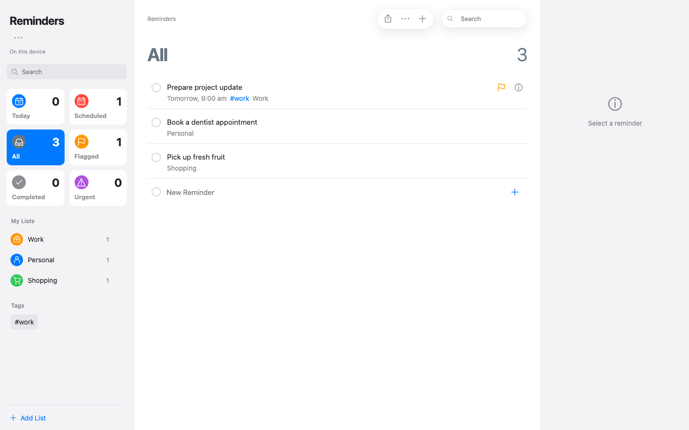
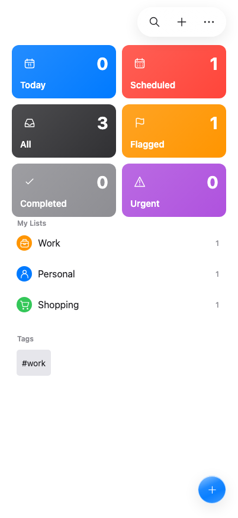

# Agent Reminders

[](https://github.com/CashpointSoulja/agent-reminders/actions/workflows/ci.yml)

A personal reminders app with an Apple-inspired interface and an API for the agents you bring.

Organise lists, dates, notes and subtasks, then explicitly delegate selected reminders to your own agent runtime. Your runtime supplies its model keys and tools; this app supplies scoped access, task claims and completion receipts.

**Status: working preview.** Core flows have automated coverage. Exact Apple UI parity, physical-device sync and named vendor integrations remain unfinished.



<details>
<summary>Phone preview</summary>



</details>

## Try it

**[Open Reminders](https://reminders-web-rea.pages.dev/)** — fictional reminders stored in your own browser, with optional selected account imports through **More → Accounts**. It does not expose a shared workspace or run agents. Your local edits survive a reload. Clearing this site's browser data removes those local copies and any cloud recovery code you chose to remember; keep that code privately first.

Google Calendar and Google Tasks need a public OAuth web client configured for this origin. The product client is not yet created: Google's required CAPTCHA panel rendered blank in both browser setup attempts; this was a setup blocker, not a provider rejection. iCloud lists need the companion's system permission and a reviewed local import or browser export. See [account linking](docs/account-linking.md). These are manual refreshes; Calendar and iCloud copies do not write back to their source.

Optional **More → Cloud Storage** is implemented for private, client-encrypted backups across devices. Opening the app does not upload reminders; enabling it is explicit, and the recovery code stays private. The isolated Worker is deployed; Pages/UI and full live-release proof remain pending for this change. See the [cloud user guide](docs/cloud-storage-user-guide.md) and [requirements](docs/requirements.md).

Externally scoped agent execution and private R2 attachments require the separate server-backed instance described below. Encrypted cloud storage does not enable those APIs.

## Features

- Lists and smart views, colours, icons, emoji and shopping sections.
- Dates, times, custom repeats, notes, links, tags, flags and priorities.
- Drag to reorder, nest and unnest subtasks; collapse a parent with its count.
- Reusable templates and independently copied template attachments.
- Light and dark layouts with translucent floating controls and reduced-motion/contrast fallbacks.
- A password-protected workspace, revision-guarded writes and private attachments.
- Agent discovery, OpenAPI, scoped tokens, leased claims and evidence-backed completion receipts.
- An opt-in iOS companion for selected-list import and completion-only writeback.
- Browser-local Google Calendar/Tasks imports and reviewed iCloud imports, with conflict preservation and separately enabled Google Tasks completion.
- Optional encrypted Cloudflare storage of reminders, original sections when supplied, templates and safe import mappings; explicit cross-device preview and conflict choices.

Agent and device server features are separate opt-ins. The public playground does not provide their server authority. Shopping categorisation uses a local English vocabulary; it does not reproduce Apple's classifier. Section-aware imports preserve source names, order and membership, while public EventKit alone cannot recover missing original sections; [Mac recovery](docs/native-sections.md) still awaits permission and private-interface acceptance.

## Run locally

Requirements: Node.js 22.19 or later and npm. Native builds additionally require macOS and Xcode.

```sh
git clone --branch rea-reminders-build https://github.com/CashpointSoulja/agent-reminders.git
cd agent-reminders
npm ci
npm start
```

Open [localhost:8081](http://localhost:8081) to play with the browser-local demo. No login, secrets or Cloudflare account are needed for that mode.

For a private server-backed instance, copy `.dev.vars.example` to `.dev.vars` and edit it locally: choose an owner password and generate a session secret of at least 32 characters. This ignored file must never enter Git. Keep `DEV_MODE=1` and `APP_ORIGIN=http://localhost:8081` for development.

Start the API in one terminal:

```sh
npm run api:migrate
npm run api:dev
```

Start the web app in another:

```sh
npm run start:server
```

Open [localhost:8081](http://localhost:8081) and sign in with the password you configured. Stop the demo development server before starting server mode on the same port. API traffic is proxied to localhost:8787, keeping browser cookies on the same origin.

For Cloudflare deployment, resource provisioning and feature flags, see [self-hosting](docs/SELF-HOSTING.md).

## Bring your agent

On an instance with `AGENT_API=1`, open `/settings/agents`, register your runtime and issue a scoped token. Configure it in the runtime's private secret store, then assign a reminder with clear completion criteria.

Your agent polls its assignments, claims one, performs the work using its own tools, verifies the result and reports evidence. A successful receipt completes the assigned occurrence. The app does not collect model-provider keys and does not execute arbitrary reminder text.

Machine entry points:

- `/llms.txt`
- `/.well-known/reminders-agent.json`
- `/api/agent/discovery`
- `/api/agent/openapi.json`
- `/api/agent/guide`

See the [agent API](docs/AGENT-API.md) and the [reference client](scripts/agent-client.mjs). OpenClaw, Hermes, Grok and other agents can implement this HTTP contract; vendor-specific adapters are not included or verified.

## Architecture

```text
Web UI ── same-origin API ── Cloudflare Worker
                              ├── D1: private workspace, claims and receipts
                              └── R2: private attachments

External agent ── scoped task API ── Worker
Optional iOS companion ── selected-list device API ── Worker

Browser-local app ── optional encrypted /cloud storage ── isolated Durable Object
```

The source is React/Expo Web, plain JavaScript Worker modules and a small Swift companion. The source owner/agent/device API uses D1 and R2; it is disabled in the public playground deployment. Optional cloud storage uses a separate SQLite-backed Durable Object and stores encrypted documents, not executable agent tasks. Agent tools and inference run outside the app. The native companion uses public EventKit on the user's device; it does not ask for Apple ID credentials.

## Test and build

```sh
npm test
npm run build
```

`npm run build` exports the private server-backed web app. `npm run build:demo` exports the browser-local playground. Neither command deploys anything.

For a static-only playground artifact, run `npm run build:demo` followed by `node scripts/prepare-demo.mjs`. Publish only `work/demo-static` from a directory without `functions/`, Worker configuration or service bindings. Its API routes explicitly report that agent and device services are disabled.

The optional cloud release has a separate preparation script and Pages configuration that binds only the encrypted storage service. See [private cloud deployment](docs/private-cloud-storage.md); do not attach the owner API to a public playground as a shortcut.

The unit/integration suite includes real SQLite transaction tests with a D1 adapter and fake R2. Browser and iPhone simulator checks cover selected flows using fictional data; they do not establish whole-screen pixel equality or physical-device sync.

The original public release passed 153 automated tests and browser checks for save/reload persistence, independent-browser isolation, completion/reopening, subtasks, templates and shopping categories. Account adapter/import tests additionally use synthetic provider responses to check permissions, paging, dates, conflict preservation, missing data, selected-task completion and reconnection races. These checks do not prove real OAuth consent or physical Apple sync.

The recorded account-linking release passed 173 tests and live browser checks. See [verification scope](docs/account-verification.md) for those precise runs and remaining provider/hardware acceptance; the newer storage/section release has separate gates.

New section/import and encrypted-storage contracts have synthetic test coverage. These source checks do not establish the pending cloud release or recovery of original sections from a real Mac. The owner reports that the phone import worked; that report is not automated real-account or full-sync acceptance.

Optional macOS checks:

```sh
native/ios/test.sh
native/ios/test-device.sh
native/ios/build.sh
```

## Documentation

[Product requirements](docs/prd.md) · [Features](docs/FEATURES.md) · [User guide](docs/USER-GUIDE.md) · [Accounts](docs/account-linking.md) · [Cloud storage](docs/cloud-storage-user-guide.md) · [Requirements tracker](docs/requirements.md) · [Architecture](docs/ARCHITECTURE.md) · [REST API](docs/API.md) · [Agent API](docs/AGENT-API.md) · [Agent-layer design](docs/LLM-LAYER-DESIGN.md) · [Roadmap](docs/ROADMAP.md) · [All docs](docs/README.md)

## Limits and privacy

This is a small single-owner application, not a multi-tenant service. OS notifications, geofences, full collaboration, offline conflict merging and hosted LLM execution are not implemented. Exact native styling and motion are still in progress.

The native bridge is manual and opt-in. Public EventKit cannot reproduce every private Apple Reminders field or original section metadata. The separately permissioned Mac section helper uses a private local interface and remains unaccepted against real data. Phone import is user-attested; physical-device Keychain, complete field fidelity and completion writeback still need acceptance testing. Use fictional data while evaluating these features.

The repository contains source and synthetic fixtures, not account exports, owner recordings, deployed secrets or private audit history. See [SECURITY.md](SECURITY.md) before exposing an instance publicly.

## Contributing and licence

Contributions are welcome. Read [CONTRIBUTING.md](CONTRIBUTING.md) for the workflow and [THIRD_PARTY_NOTICES.md](THIRD_PARTY_NOTICES.md) for included data and dependencies.

Project code is licensed under [MIT](LICENSE). Agent Reminders is an independent project and is not affiliated with Apple. Apple Reminders and Apple are trademarks of their respective owner.
