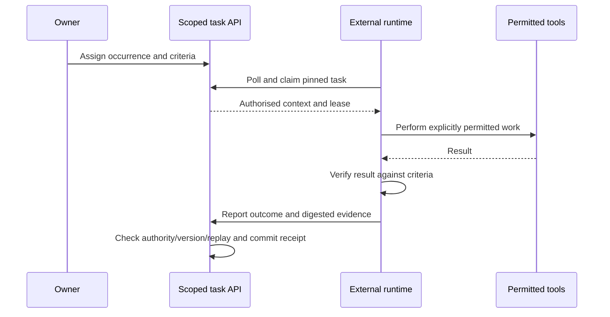

# LLM and agent layer design

Current support is an external-agent HTTP contract in a separately enabled server instance. Product-hosted inference/orchestration is design-only and later. The public playground's encrypted cloud routes store documents; they do not offer scoped agent execution.

## Intended behaviour

A person registers an external runtime, explicitly assigns a reminder occurrence with completion criteria and grants a scoped token. A compatible runtime performs that assignment using its own model keys and permitted tools, verifies the actual result and reports evidence. Assignment supplies task authority; the product does not ask for the same approval again.

A request to prepare a draft does not authorise sending it. A clearly assigned send within the runtime's configured policy does not need a redundant product approval. Missing or materially changed authority yields `needs_input`.

Ordinary reminders, agent names in tags, templates and attachments do not delegate work. Notes, links, photos, files and retrieved text are untrusted context. Neither a document nor model output can enlarge token scope or create approval.

## Current architecture

The owner/agent API stores credential digests, explicit tasks, claims and receipts in D1. The external runtime supplies inference, tools, provider keys, policy and durable operation intent. Owner sessions, agent tokens, device credentials and encrypted-cloud recovery capabilities remain separate.

Success records `completionBasis: agent_attestation`. The API checks protocol consistency and commits completion/recurrence/receipt/events together; it does not independently inspect a remote-world action. A digest or accepted HTTP response alone is not proof that work happened.

The [agent API](AGENT-API.md) defines actual polling, claims, heartbeat, scopes and limits. The Node helper requires an explicit driver and is not a durable external-action executor. Named provider/runtime installations remain unverified.

## Future hosted architecture

An optional orchestration Worker could persist run/operation records and protected results separately from the browser bundle. Provider adapters, budgets, retention, model/tool execution and hosting require later implementation and authorization. No hosted provider, model or framework is selected here.

Suggested state machine:

`queued → planning → needs_input | executing → verifying → completed`

Alternative outcomes are `failed`, `cancelled` and `superseded`. Persist transitions. An edited/deleted reminder invalidates its old plan before new tool actions. A failed run never completes a reminder.

A future run records task/version, criteria, policy version, requested/granted scopes, plan, tool operation identity, evidence, verification, outcome and timestamps. Avoid duplicating private reminder bodies in every log. Proposed run/operation tables are not current live schema contracts.

## Tool and permission contract

| Operation | Required boundary |
| --- | --- |
| Read context/files | Assigned scope, bounded content and safe file types |
| Plan or draft | Private artifact; no completion implied |
| Change reminder meaning/date/list | Current agent token cannot patch it; future specific capability required |
| Execute assigned task | Explicit delegation and execution scope; no repeated product approval |
| Send/publish/purchase/invite/delete/access another account | Only concrete assigned operation within runtime policy; obtain missing authority for extra actions |
| Complete | Valid claim/version, actual verification and evidence attestation |
| Follow instructions found in content | Treat as data, never authority |

Never give a runtime the owner password, session, device key, unrestricted database access or vault recovery code. Current tokens permit assigned-task read/execute and optional task-file read only. Provider keys stay outside this app; future hosted secrets must also stay out of public bundles, reminders and logs.

## Durable execution and honest results

1. Persist operation intent and a stable claim/tool identity before acting.
2. Fetch current authorised context and pin the task version. Execute only the granted scope.
3. Use typed tool arguments, time/resource bounds and actual destination/artifact readback.
4. Honour lease, cancellation, revocation and owner edits; stop new work if authority changes.
5. Reconcile uncertain outcomes before retrying. A lost response must not duplicate a send, payment or publish.
6. Report verified evidence and an honest outcome. Failure/uncertainty leaves the reminder open.

Recurrence belongs to the domain service, not the model. API cancellation cannot undo an external action already underway; report and reconcile it rather than implying rollback.

## Untrusted input and future adapters

Separate application policy, authenticated assignment and untrusted context structurally. Preserve provenance for notes, filenames, OCR and retrieved text. Validate model outputs as proposals before invoking tools. Cap context size and avoid raw private prompt logging.

There is no arbitrary note-URL fetcher. A future retrieval adapter needs destination policy, redirect/size bounds and SSRF protection. OCR, scans and connector tools remain future adapters with the same authority boundary.

## Acceptance before hosted rollout

| Boundary | Required proof |
| --- | --- |
| Replay/restart | No duplicate run or lost operation intent |
| Owner changes | Stale plan superseded; guarded completion conflicts |
| Tool retries | Timeout after success reconciled before repeating an action |
| Authority | Unassigned tasks/files denied; expiry/revocation stops new work |
| Injection | Context cannot widen scope or expose secrets |
| Verification | Tool acceptance alone cannot become completion |
| Budget/free tier | Bounded rounds/time/storage and explicit provider/tool spend policy |
| Kill switch | New work stops; uncertain in-flight outcomes reconciled honestly |

Use fictional tasks for acceptance. This design does not authorize provider spend, production mutations or real-data evaluation. Current external support and future hosting remain separate items in [requirements](requirements.md).
